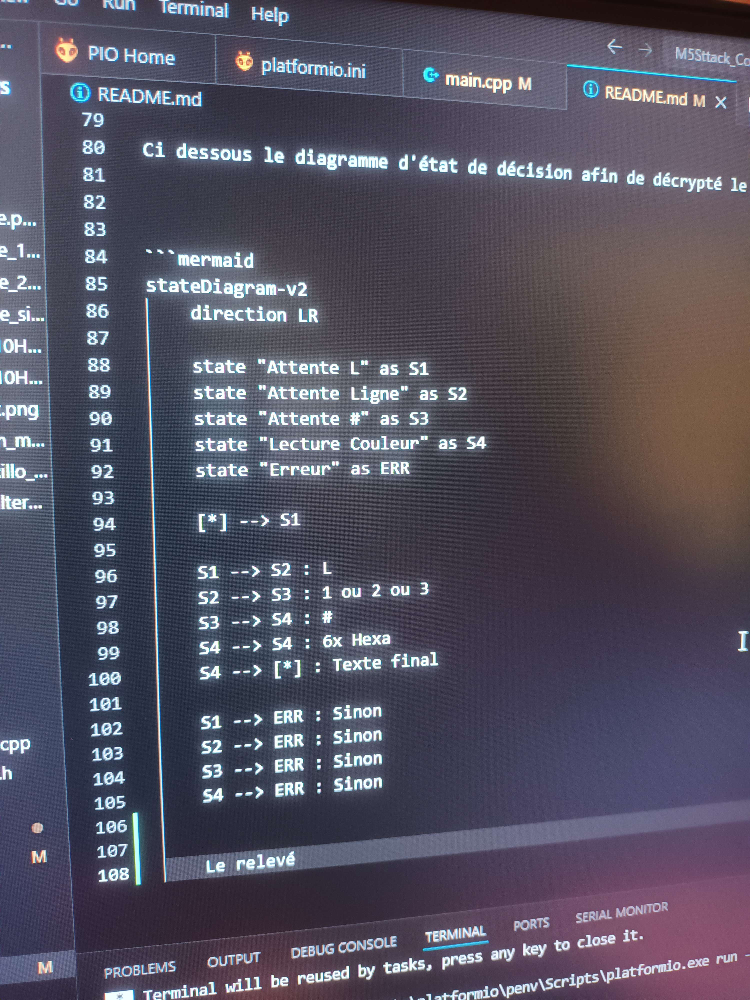
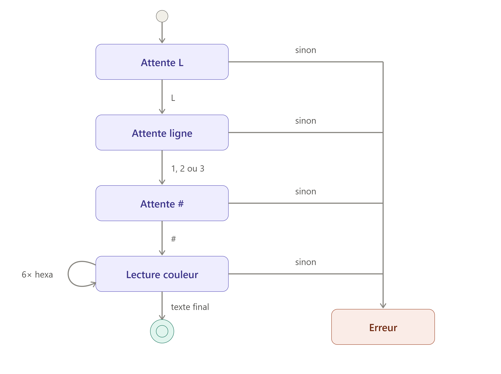

le programme lit la tension d'un potentiomètre toutes les 2ms, puis il calcule la moyenne glissante sur 128 
échantillons et l'envoie sur le port série. Pour ce faire, on utilise le timer 0 qui déclenche une interruption
qui donne le sémaphore à la tâche.

Les #défine : 
	- on définit GPIO 36 comme broche de lecture pour lire la tension du potentiomètre
	- nombre d'échantillons de la moyenne glissante
	- on utilise le timer 0
	- on règle le timer de sorte que 1 tick = 1 µs
	- 2000 µs = 2 ms

Fonction setup() : 
	- création du sémaphore binaire
	- création de la tache lecture
	-configuration du timer

Fonction loop() : 
	- vide, tout se fait dans la tâche et l'ISR

Fonction timerIsr() : 
	- libère le sémaphore toutes les 2 ms

Fonction taskReadCAN() : 
	- déclaration de variables locales pour le tableau
	- boucle infinie : 
		- la tache attend que l'ISR donne le sémaphore
		- lit la tension et renvoie une valeur binaire grâce au CAN
		- calcule la moyenne glissante
		- envoie sur le port série